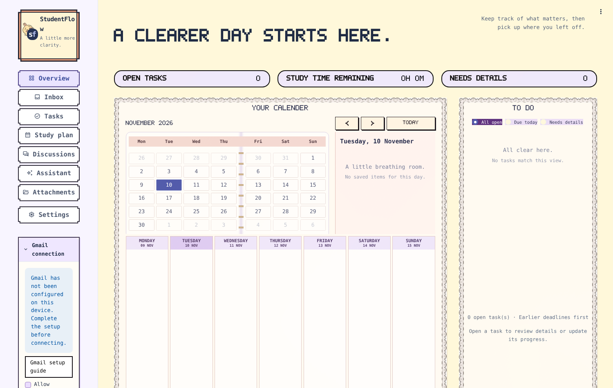

# StudentFlow

Turn email and discussions into a clear study plan.

StudentFlow is a local productivity application for students. It connects to Gmail, Google Chat and Google Calendar to help organize tasks, plan study time, draft replies and summarize discussions.

The interface is in English. Original messages, quotations and user-entered content retain their source language. A sidebar connects the workspaces; Inbox pairs a searchable, multi-select message list with reading, task extraction and category review. Discussions also has a direct sidebar entry.

## Features

- **Email categories and labels:** classify selected emails as Needs reply, Needs action or No action needed. Review evidence and correct categories, rename labels or add custom labels, then optionally preview and confirm Gmail updates.
- **Email to tasks:** identify flexible study tasks and fixed appointments from selected emails and readable PDF or Word attachments. Review deadlines, supporting text and suggested study time before saving.
- **Study planning:** plan around weekly availability, date exceptions, meals, breaks and fixed commitments. Track completed work and replan remaining tasks.
- **Calendar sync:** preview and sync saved study sessions and confirmed appointments to a dedicated StudentFlow calendar.
- **Email replies:** generate editable drafts using an optional writing sample, save reply preferences and send reviewed replies through Gmail.
- **Meetings and discussions:** select messages from a Google Chat space, summarize decisions and action items, and prepare agendas and follow-up drafts. Download minutes in Word, TXT or Markdown format.
- **Attachment library:** retain, search, download and remove saved attachments on your device.

## Requirements

| Item | Details |
| --- | --- |
| Computer | Windows, macOS or Linux with a web browser; about 1 GB free disk space |
| Python | 3.12.6 or later, or 3.13 (the project pins 3.13); uv downloads it if missing |
| [uv](https://docs.astral.sh/uv/) | Installs the exact, locked dependencies |
| Git | To clone the repository (or download the ZIP from GitHub) |
| OpenAI API key | With API credit. Default model `gpt-5.6-terra`, chosen by our five-model evaluation; about USD 0.04 per email processed |
| Google account and Google Cloud project | Free. Needed for Gmail, Google Calendar and Google Chat; each user creates their own OAuth client |

## Install

Open a terminal (PowerShell on Windows, Terminal on macOS) and run:

```bash
git clone https://github.com/yihua127/studentflow.git
cd studentflow
uv sync --locked
```

If `uv` is not installed, install it first with `pip install uv` or the installer on [docs.astral.sh/uv](https://docs.astral.sh/uv/). `uv sync --locked` creates a `.venv` folder with the exact versions in `uv.lock` (about 2 minutes the first time).

## Add your OpenAI key

- Start the app (below), open **Settings**, paste your key, keep Model ID `gpt-5.6-terra`, select **Save AI settings** and then **Test AI connection**; or
- copy `.env.example` to `.env` and fill in `OPENAI_API_KEY`. `.env` is ignored by Git.

Help with API credit and keys: [OpenAI setup](docs/OPENAI_SETUP.md).

## Set up Google access (one time, about 10 minutes)

Each user connects their own Google account through their own Google Cloud project. No credentials are stored in this repository.

1. Sign in to the [Google Cloud console](https://console.cloud.google.com/) and create a project named **StudentFlow**.
2. Under **APIs & Services → Library**, enable **Gmail API**, **Google Calendar API** and **Google Chat API** (Chat is only needed for Discussions).
3. In **Google Auth Platform**, set Branding (app name StudentFlow, your email), set Audience to **External**, keep it in **Testing** and add your Gmail address under **Test users**.
4. Under **Data Access**, add these scopes (all start with `https://www.googleapis.com/auth/`):
   - `gmail.readonly`: read the inbox
   - `gmail.send`, plus `openid` and `userinfo.email`: send reviewed replies
   - `gmail.modify`: apply category labels
   - `calendar.calendarlist.readonly`, `calendar.events.readonly`, `calendar.app.created`: read calendars and sync to a dedicated StudentFlow calendar
   - `chat.spaces.readonly`, `chat.messages.readonly`: Discussions
5. Under **Clients**, create a **Desktop app** client, download the JSON file and save it as `credentials/gmail_client.json` in the project folder.

Full guide: [Gmail setup](docs/GMAIL_SETUP.md). In Testing mode, Google asks you to sign in again every 7 days.

## Run

```bash
uv run --locked streamlit run app.py --server.address 127.0.0.1 --browser.gatherUsageStats false
```

Open http://localhost:8501 and keep the terminal open while you use the app (`Ctrl+C` stops it).

Optional on Windows: run `powershell -NoProfile -ExecutionPolicy Bypass -File .\install-desktop-shortcut.ps1` once to add a StudentFlow desktop icon (it starts the app with `start.ps1`).



### Your first five minutes

1. **Connect Gmail:** in the sidebar, tick the permission box under **Gmail connection**, select **Connect Gmail** and sign in with a test-user account. Then open **Inbox** and select **Refresh inbox**.
2. **Sort your inbox:** tick a few emails, open **Email categories** and classify them. Review each category and its reason.
3. **Get tasks:** open **Tasks & events** and analyse the selected emails. Check deadlines and study time, fill anything missing and save. Tasks are planned only after you confirm them.
4. **Plan:** in **Study plan**, set your available hours and generate a plan. Unscheduled work is listed with a reason. Optionally preview and sync to Google Calendar.
5. **Reply:** open an email and select **Reply to this email**. Edit the draft; sending needs a separate Gmail permission and explicit confirmation.

## Using StudentFlow

### Organize tasks and plan study time

In **Inbox (Gmail)**, select messages and choose **Analyze selected messages**. Review task and appointment suggestions, adjust missing details and save the items you want to use. Tasks need a deadline and a positive study-time estimate before they can be confirmed for planning.

In **Tasks**, search or filter your task list and open a card to review its details, supporting text and progress. The full table and CSV export remain available.

In **Study Plan**, use **Availability & preferences** to set your weekly hours and date changes, and **Commitments & calendar** to manage fixed events. In **Schedule**, generate a plan and review its daily agenda or table before saving. The planner prefers whole-hour starts when feasible while respecting deadlines and scheduling constraints. Record completed study time and use **Replan remaining tasks** to update the schedule.

Use **Google Calendar sync** to preview changes before applying them. Sync is manual and one-way from StudentFlow to its dedicated calendar; edits made in Google Calendar are not imported.

### Draft email replies

Open a message in **Inbox → Read email** and choose **Reply to this email**, or use **Reply with assistant** from task/category review. In **Assistant → Email replies**, optionally provide a writing sample and save your reply preferences. Review and edit the subject and message, then download the draft. To send it, verify the recipient under **Send with Gmail** and explicitly confirm.

### Classify email

In **Inbox → Email categories**, select any number of loaded messages and allow classification; they are classified three at a time, so larger selections take longer. Review the suggested categories and supporting quotations, edit any category and save locally. Use **Filter by label** to filter the inbox list and **Show category results** to narrow the review table. **Needs reply** takes priority when a message also requests another action; the explanation preserves that action. **No action needed** means informational mail, not deletion or spam.

Use **Manage labels** to rename the three categories or create additional labels such as Coursework or Urgent. Under **Message details → Edit labels**, choose a primary category and any custom labels, then **Save label changes**. Custom labels are selected manually; renaming a category does not change its AI classification rule.

To show labels in Gmail, choose **Connect Gmail labels**, then **Preview Gmail label changes**. Confirm the exact changes and select **Apply Gmail labels**. Only the selected messages' registered `StudentFlow/` labels are adjusted; other labels and read status are preserved. Renamed labels replace their previous names on the selected messages after confirmation; other messages keep their existing labels until synced. Classification uses email text rather than attachments; incomplete results remain unclassified.

### Summarize meetings and discussions

In **Assistant → Meetings & discussions**, load a Google Chat space and select the messages to analyze. Review the summary, decisions, action items, open questions and supporting quotations. Use **Download minutes (Word)** to save an editable document, or choose TXT or Markdown.

Email replies and discussions have separate inputs and preferences. **Other assistance** supports broader task and planning questions using the information you select.

## Data and user control

- Account credentials, tasks, preferences, attachments and saved plans are stored locally. They are excluded from this repository.
- Loading information from Google does not automatically send it to OpenAI. AI processing requires consent for the selected information; task analysis may also use related saved task details for duplicate checks.
- Generated replies, estimates, tasks and summaries require review. Missing dates, owners and event times may need clarification.
- Sending email, applying Calendar changes and syncing Gmail labels require explicit user confirmation. The assistant does not send messages automatically.
- Disconnecting a Google account removes its local sign-in; previously saved tasks remain available.

## Scope

StudentFlow uses a coordinator with email, task, planning and meeting specialists. Supporting quotations are checked against selected sources, and schedules are checked against planning rules.

For detailed workflows and setup help, see the [User guide](docs/USER_GUIDE.md). Validation coverage and remaining limitations are documented in [Testing](docs/TESTING.md).

## Troubleshooting

| Problem | What to do |
| --- | --- |
| `uv` is not recognized | Install uv (`pip install uv`), then open a new terminal |
| "Gmail has not been configured" | `credentials/gmail_client.json` is missing or misnamed; redo step 5 of the Google setup |
| Google says "Access blocked" or the app is unverified | Add your address under **Test users** in your own Cloud project and sign in with that account |
| Google keeps asking for a passkey | Choose **Try another way** and sign in with your password, or finish sign-in in a normal browser window |
| AI connection failed | Check the API key, API credit and that the model ID is one your key can use |
| Port 8501 already in use | Close the other StudentFlow window, or add `--server.port 8502` to the run command |
| Page stops responding after many clicks | Wait for the running indicator (top right) to stop, or press F5 to reload |

## Development and tests

```bash
uv run --locked python -m pytest -q
```

Tests use synthetic inputs, scripted models and mocked Google services, so they need no API key or account. Clean-checkout checks on commit `e2f5619` (10 Nov 2026): a fresh clone on Linux with Python 3.13 installed in about 2 minutes and passed 1,676 tests (21 Windows-only tests skipped), and the app started; the full suite on Windows 11 passed 1,697 tests. The live quantitative evaluation (five models, held-out set) is described in our Evaluation report.

Entry point: `app.py`. Application modules: `src/studentflow/`. Tests: `tests/`. Guides: `docs/`.
